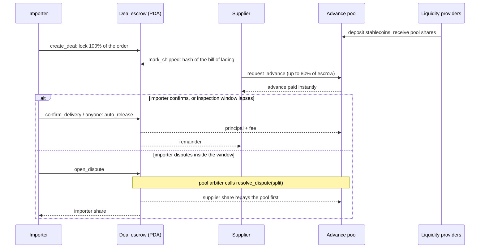

<p align="center"></p>

# Capstan

**Escrow-backed advances for cross-border trade, on Solana.**

An importer locks the full order amount in a program-owned escrow. Once the supplier posts proof of shipment, the supplier can draw up to 80% of that escrow as an advance from a stablecoin liquidity pool. When the goods are accepted, the escrow repays the pool first (principal plus a 1.5% fee) and pays the supplier the rest. The locked escrow is the collateral, so the advance repays itself.

- **Live app (Solana devnet):** https://capstan-trade.vercel.app
- **Pitch video:** PITCH_URL
- **Demo video:** DEMO_URL
- **Program ID (devnet):** [`2ATx5cQKsBZEyzxKfwyhkNM3KgWyGQGqykqxnfz4UBPU`](https://explorer.solana.com/address/2ATx5cQKsBZEyzxKfwyhkNM3KgWyGQGqykqxnfz4UBPU?cluster=devnet)

## The problem

Small importers and their overseas suppliers rarely trust each other enough to trade on open account. The usual compromise is a deposit up front and the balance before or at shipment, which leaves one side exposed and someone's working capital stuck while the goods are at sea. Letters of credit fix the trust problem but are slow and expensive, and supply chain finance programs are built for large buyers. The Asian Development Bank's 2026 survey puts the global trade finance gap at about [US$2.5 trillion, with 41% of SME requests rejected](https://www.gtreview.com/news/global/trade-finance-gap-stabilises-at-us2-5tn/).

## How it works



1. **Lock.** The importer opens a deal and the full amount moves into an escrow token account owned by the deal PDA. The purchase order terms are stored as a SHA-256 hash.
2. **Ship.** The supplier posts a hash of the shipping document before the ship-by date. This starts the importer's inspection window.
3. **Advance.** The supplier can draw an advance from the pool, capped at a share of the escrow set by the pool (80%), for a fee (1.5%). It lands in the supplier's wallet in the same transaction.
4. **Settle.** The importer confirms delivery, or anyone can release the escrow once the window lapses without a dispute. The escrow pays the pool back first and the supplier gets the rest.
5. **Disputes and refunds.** Inside the window the importer can dispute. The pool's arbiter splits the escrow; the supplier's share still repays the pool first and any shortfall is booked as a pool loss. If the supplier never ships, the importer takes the money back after the ship-by date.
6. **Liquidity.** LPs deposit stablecoins and receive pool shares (an SPL mint). Share value is `(idle liquidity + principal lent) / share supply`, so fees raise it and losses lower it. Only idle liquidity can be withdrawn.

## Why Solana

- **Settlement speed and cost.** The advance reaches the supplier in the same transaction that checks the escrow, for a fraction of a cent.
- **No custodian.** Funds sit in token accounts owned by program PDAs. Release rules are enforced by the program, not by an intermediary.
- **Composable money.** The program is written against the SPL token interface, so it works with SPL Token and Token-2022 stablecoin mints. LP shares are ordinary SPL tokens.
- **Permissionless settlement.** `auto_release` can be called by anyone after the window, so a silent importer can't freeze the supplier's money or the pool's capital.

## The program

Rust, Anchor 1.1.2. Source: [`programs/capstan/src/lib.rs`](programs/capstan/src/lib.rs).

| Instruction | Signer | What it does |
| --- | --- | --- |
| `init_pool` | admin | Creates the pool for a stablecoin mint: vault, share mint, fee, advance cap, arbiter |
| `deposit` / `withdraw` | LP | Moves stablecoins in and out of the pool against shares |
| `create_deal` | importer | Locks the order amount in a deal escrow |
| `mark_shipped` | supplier | Records the shipment proof hash and starts the inspection window |
| `request_advance` | supplier | Pays an advance from the pool against the escrow |
| `confirm_delivery` | importer | Releases the escrow: pool first, then supplier |
| `auto_release` | anyone | Same release, once the window has lapsed without a dispute |
| `open_dispute` | importer | Freezes the release inside the window |
| `resolve_dispute` | pool arbiter | Splits the escrow; supplier share repays the pool first |
| `refund_unshipped` | importer | Returns the escrow if the ship-by date passed without shipment |
| `faucet` | anyone | Devnet helper: mints a test stablecoin whose mint authority is a program PDA |

Accounts: `Pool` (PDA `["pool", mint]`), its vault (`["pool_vault", pool]`) and share mint (`["shares", pool]`); `Deal` (PDA `["deal", importer, deal_id]`) and its escrow (`["deal_vault", deal]`). Every state change emits an event.

## Run it

Requirements: Rust, Solana CLI, Anchor CLI 1.1.2, Node 20+.

```bash
npm install
anchor build
anchor test --validator legacy
```

The test suite runs 7 end-to-end scenarios against a local validator: pool setup and LP deposits, the full escrow and advance flow, an arbitrated dispute with a pool loss, permissionless release after the window, refund of an unshipped order, pro-rata LP withdrawal, and the faucet cap, plus authorization and limit checks along the way.

Web app (Vite + React + Solana wallet adapter):

```bash
# create a test stablecoin, a pool and seed liquidity on the target cluster
ANCHOR_PROVIDER_URL=https://api.devnet.solana.com ANCHOR_WALLET=~/.config/solana/id.json npx ts-node scripts/setup.ts
cd app && npm install && npm run dev
```

The app has two modes. **Demo wallets** keeps one devnet keypair per role in your browser so one person can walk through a deal from both sides. **My wallet** signs with any Wallet Standard wallet (Phantom, Solflare, Backpack) set to devnet.

## Built during the hackathon

Capstan was designed and built from scratch during the Colosseum Crypto World's Fair (September 14 to October 12, 2026). There is no code from before the event; open-source dependencies are listed in `Cargo.toml` and `package.json`.

## What's next

- Supplier underwriting: allowlists and per-supplier limits based on repayment history
- The arbiter as a Squads multisig, and a deadline for resolving disputes
- Shipping proofs from carrier and electronic bill of lading feeds instead of a hash posted by the supplier
- Mainnet pools in USDC after an audit, distributed through licensed payment partners in each corridor

## License

MIT
